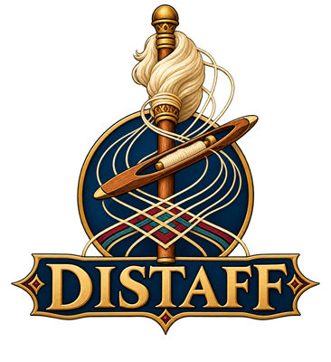
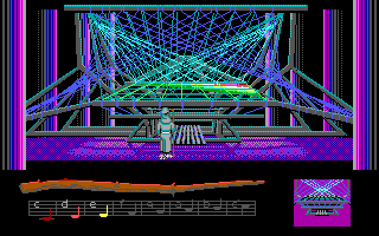
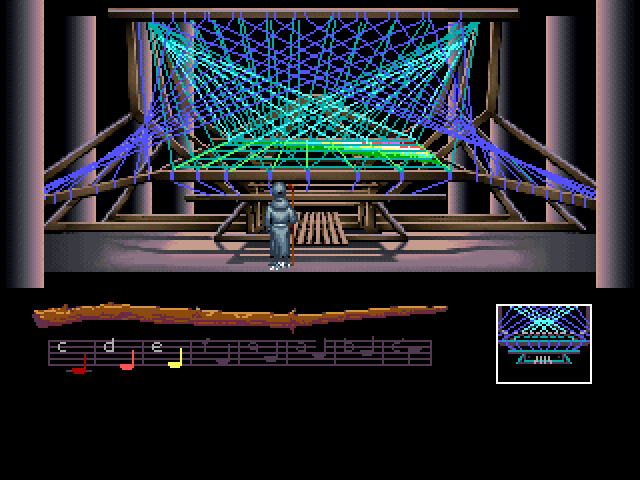
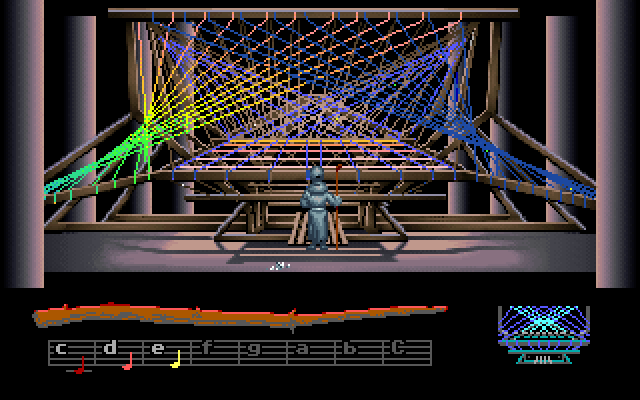
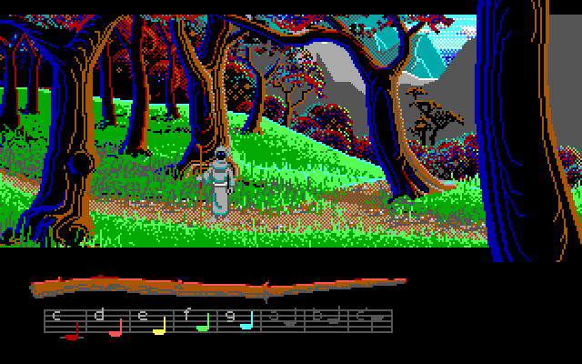
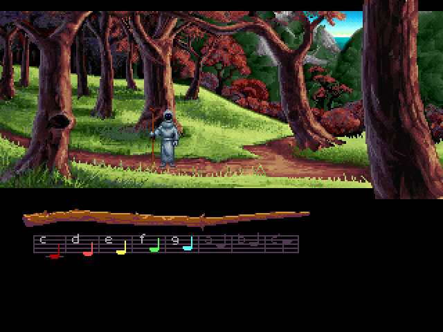
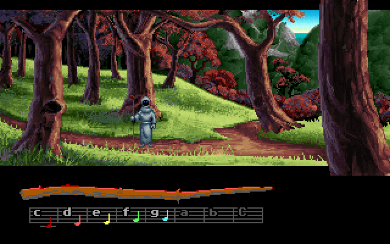

[](https://github.com/jeffnyman/distaff/actions/workflows/build.yml)
[](https://www.nuget.org/packages/Distaff)

✨ *Long live the classics.*

**Distaff** is a player for Lucasfilm Games' *Loom*, written in C#. It is a port of the parts of
ScummVM's SCUMM engine that Loom uses (SCUMM versions 3 and 4), rebuilt as a .NET library on a
small host of its own, so the same engine plays in a window on the desktop and runs headless under
test.

It plays all three of Loom's English releases, the DOS EGA, the FM Towns and the DOS VGA CD, from
the start to the end, with their sound, and saves in ScummVM's format: a save made in either one
loads in the other.

**Distaff** is not a ScummVM fork, and it plays no other SCUMM game. The full documentation, the
releases compared and how Distaff is checked are on
[GitHub](https://github.com/jeffnyman/distaff).

| EGA (1990) | FM Towns (1991) | VGA CD (1992) |
|---|---|---|
|  |  |  |
|  |  |  |

## Features

- **All three English releases**, identified by ScummVM's own table of MD5s, and played to the
  end at each of the three proficiency levels (Practice, Standard and Expert).
- **The game's own interface**: the distaff and its drafts, the save screen of the EGA and the FM
  Towns and the VGA CD's menu (F5), the pause and other banners, and the keys ScummVM's original
  interface keeps.
- **Sound as ScummVM plays it**, checked sample for sample against ScummVM's own code:
  - the EGA on the PC speaker, the PCjr/Tandy, the Creative Music System (Game Blaster) or the
    AdLib, and the Roland Upgrade's music on an emulated MT-32 or CM-32L from your own ROMs;
  - the FM Towns' sound on its FM and PCM chips, and its music from its CD audio tracks;
  - the VGA CD's voices and music from its CD audio track, with subtitles.
- **ScummVM-compatible saves**: Distaff's saves load in ScummVM and ScummVM's load here, the
  music playing on from where it was saved.
- **The FM Towns' smooth scrolling**, and ScummVM's semi-smooth option.
- **The same on Windows, Linux and macOS**, to the byte.
- **A headless mode** that plays from scripted clicks and keys and writes screenshots, sound and
  video.

## Game data

Distaff ships no game data: point it at a folder holding one of the releases, as it came on its
disks or CD. The FM Towns' and the VGA CD's audio is read from their CD tracks kept as files beside
the game (`Track1.flac` and on, or `.ogg`), as ScummVM keeps them.

| Release | Index | MD5 | CD audio |
|---|---|---|---|
| DOS EGA, English | `00.LFL` | `37f56ceb13e401a7ac7d9e6b37fecaf7` | |
| FM Towns, English | `00.LFL` | `c5d10e190d4b4d59114b824f2fdbd00e` | `Track1` to `Track16` |
| DOS VGA CD, English | `000.LFL` | `5d88b9d6a88e6f8e90cded9d01b7f082` | `Track1` |

## The player

With the [.NET 10 runtime](https://dotnet.microsoft.com/download):

```
dotnet tool install -g Distaff
distaff <game folder>
```

| Option | What it does |
|---|---|
| `--scale N`, `--fullscreen` | The window's size (1 to 8, 3 by default), or the full screen. |
| `--sound speaker\|pcjr\|cms\|adlib\|mt32` | The EGA's sound card; the AdLib by default. |
| `--mt32-roms folder`, `--mt32-model mt32\|cm32l` | The Roland Upgrade on an emulated MT-32, from a folder holding a control and a PCM ROM; the model, when the folder holds both. |
| `--music-volume N`, `--sfx-volume N` | 0 to 256, 192 by default, as ScummVM's. |
| `--text-speed N` | 0 to 9, 6 by default; '+' and '-' change it on the VGA CD. |
| `--no-subtitles` | Hides the VGA CD's lines while they are spoken, as a fresh ScummVM does. |
| `--difficulty practice\|standard\|expert` | The proficiency level, which the FM Towns takes at boot. |
| `--copy-protection` | Keeps the EGA's Book of Patterns check. |
| `--no-smooth-scroll`, `--semi-smooth-scroll` | The FM Towns' scrolling: off, or ScummVM's semi-smooth option. |
| `--load file`, `--saves folder`, `--target name` | Starts from a save; where saves are kept; the name they take (`loom-ega`, `loom-fm`, `loom-vga`, as ScummVM names them). |
| `--random-seed N` | The random numbers' seed, from the clock otherwise. |
| `--version` | Prints the player's version. |

In the game, F5 opens the save screen or the VGA CD's menu, the space bar pauses, Escape skips a
cutscene, and Ctrl+C or Alt+X quits.

The same engine runs without a window, from scripted clicks and keys, and writes what it shows
and plays:

```
distaff <game folder> --run 2000 --click 100:160,92 --key 200:esc --screenshot end.png --wav sound.wav
```

`--save step:file` saves along the way, and `--video file.mp4` records the run (with
[ffmpeg](https://ffmpeg.org)). `--room N` draws a room as a PNG and lists its objects, and
`--script N` and `--room-scripts N` disassemble scripts.

## The library

The engine is a library, `Distaff.Scumm`, and `Distaff.Audio` with it for the CD audio and the
MT-32:

```
dotnet add package Distaff.Scumm
dotnet add package Distaff.Audio
```

`Loom` is the front door. It opens a release from its folder (or one a level or two below it),
plays it headless, looks inside it, or gives a host of your own the engine that plays it:

```csharp
using Distaff.Audio;
using Distaff.Scumm;
using Distaff.Scumm.Graphics;

var game = Loom.Open(folder);
Console.WriteLine(game);                       // Loom (VGA)

var world = game.Play(cdTracks: CdTrackFiles.In(folder));
world.Boot();
for (int i = 0; i < 600; i++)
{
    world.Step();
}

File.WriteAllBytes("screen.png", PngWriter.Encode(world.Frame(), 2, 2));
Console.WriteLine(string.Join(" / ", world.MessageLog));
```

A missing folder, a folder with no release, and a release Distaff does not play each throw their
own exception (`DirectoryNotFoundException`, `FileNotFoundException`, `NotSupportedException`).
Headless, the game is played with `Click`, `KeyDown` and `Step`, saved and loaded with `Save` and
`Load`, and watched with `GetActor`, `ActorsHere`, `RunningScripts`, `ShownVerbs` and
`Variables`; `Audio` is its sound, which an audio device may read from a thread of its own, and
`VideoRecorder` records it. `Inspect()` draws a room with its objects and disassembles scripts:

```csharp
var inspector = Loom.Open(folder).Inspect();
foreach (int number in inspector.Rooms)
{
    var room = inspector.Room(number)!;
    Console.WriteLine($"Room {number}: {room.Width}x{room.Height}, {room.Objects.Count} objects");
}

foreach (var line in inspector.Script(1)!.Lines)
{
    Console.WriteLine(line);                   // [0000] Var[60] = move(0)
}
```

Every public member is documented, and the public API is promised under semantic versioning: a
change that would break code written against it waits for a new major version, and each release
is checked against the last one published.

## Known limitations

- **Two things not yet compared with ScummVM's window:** the VGA CD's snap scroll banner (Ctrl+R),
  which Distaff shows as ScummVM's code reads but which one run of ScummVM did not show; and the
  frames after a load from inside the game, where a load from the launcher has been compared.
- **English only:** the EGA, FM Towns and VGA CD releases in English. Other languages, the
  Amiga, Atari ST, Macintosh and PC Engine releases, and the FM Towns' Japanese text are not
  played.

## Acknowledgements

Distaff stands on [ScummVM](https://www.scummvm.org/)'s SCUMM engine, whose code it follows and
checks itself against, and on [Munt](https://github.com/munt/munt)'s MT-32 emulation. Loom is a
trademark of Lucasfilm Ltd.; the screenshots are of the game as Distaff plays it, for
illustration.

## Author

Made with 🤍 by [Jeff Nyman](https://github.com/jeffnyman):
[website](https://testerstories.com), [LinkedIn](https://www.linkedin.com/in/jeffnyman/).

## Doxazein (δοξάζειν)

> חֶסֶד וֶאֱמֶת אַל־יַעַזְבֻךָ קָשְׁרֵם עַל־גַּרְגְּרֹתֶיךָ כָּתְבֵם עַל־לוּחַ לִבֶּךָ
>
> "Let not mercy and truth forsake thee:\
> bind them about thy neck;\
> write them upon the table of thine heart."
>
> *Proverbs 3:3*

## License

**Distaff**, A Player for *Loom*. Copyright (C) 2026 [Jeff Nyman](https://github.com/jeffnyman).

This program is free software: you can redistribute it and/or modify it under the terms of the
[GNU General Public License](https://www.gnu.org/licenses/gpl-3.0.en.html) as published by the
Free Software Foundation, either version 3 of the License, or (at your option) any later version.
It is distributed in the hope that it will be useful, but WITHOUT ANY WARRANTY; without even the
implied warranty of MERCHANTABILITY or FITNESS FOR A PARTICULAR PURPOSE.

The MT-32 emulator in `Distaff.Audio` is a port of Munt, under the LGPL 2.1 or later; each of its
files keeps Munt's copyright notice. Distaff ships no game data and no MT-32 ROMs.
