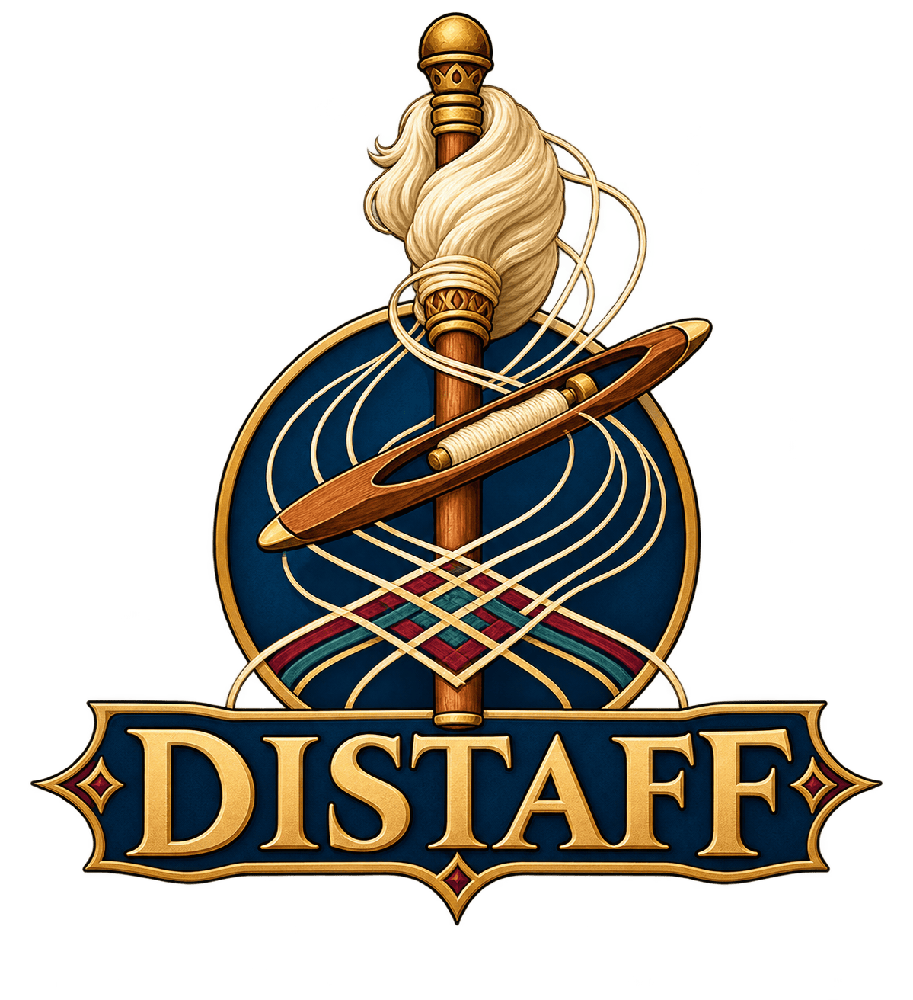
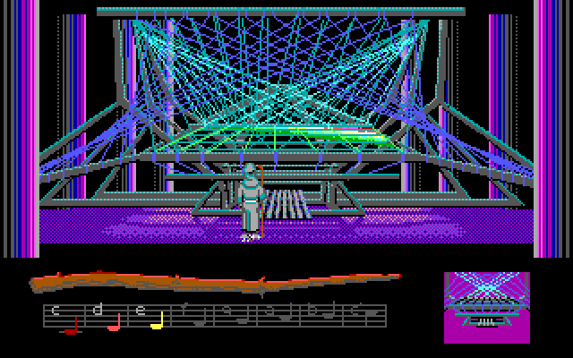
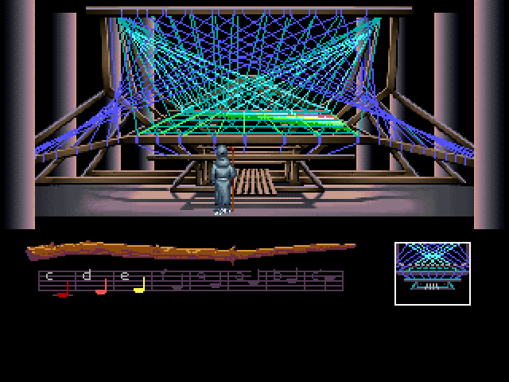
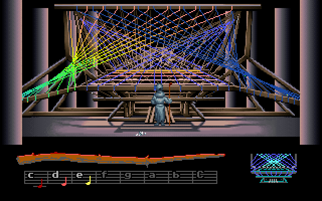
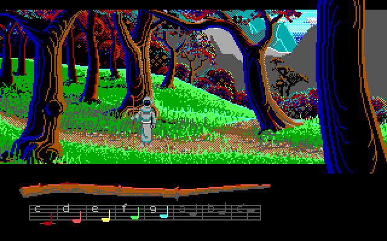
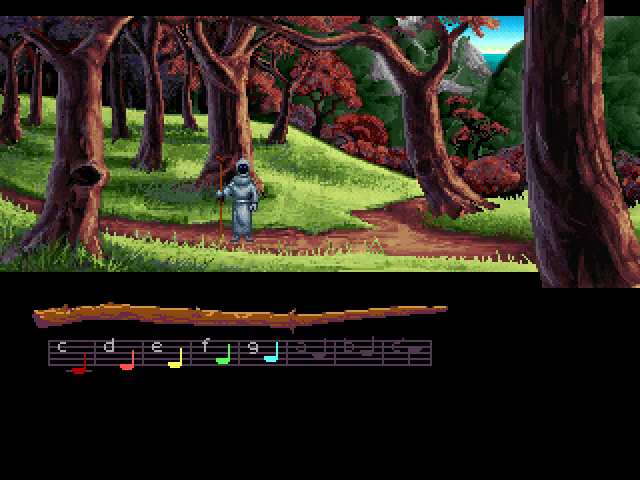
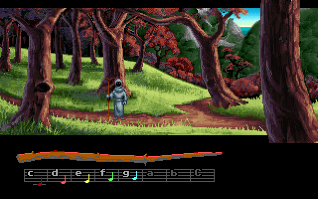

<h1 align="center">
  
</h1>

[](https://github.com/jeffnyman/distaff/actions/workflows/build.yml)
[](LICENSE)

<p align="center">
  ✨ Long live the classics.
</p>

**Distaff** is a player for Lucasfilm Games' *Loom*, written in C#. It is a port of the parts of
ScummVM's SCUMM engine that Loom uses (SCUMM versions 3 and 4), rebuilt as a .NET library on a
small host of its own, so the same engine plays in a window on the desktop and runs headless under
test.

It plays all three of Loom's English releases, the DOS EGA, the FM Towns and the DOS VGA CD, from
the start to the end, with their sound, and saves in ScummVM's format: a save made in either one
loads in the other.

**Distaff** is not a ScummVM fork, and it plays no other SCUMM game.

| EGA (1990) | FM Towns (1991) | VGA CD (1992) |
|---|---|---|
|  |  |  |
|  |  |  |

## Features

- **All three English releases**, identified by ScummVM's own table of MD5s, and played to the
  end at each of the three proficiency levels (Practice, Standard and Expert).
- **The game's own interface**: the distaff and its drafts, the save screen of the EGA and the FM
  Towns and the VGA CD's menu (F5), the pause and other banners, and the keys ScummVM's original
  interface keeps.
- **Sound as ScummVM plays it**, checked sample for sample against ScummVM's own code:
  - the EGA on the PC speaker, the PCjr/Tandy, the Creative Music System (Game Blaster) or the
    AdLib, and the Roland Upgrade's music on an emulated MT-32 or CM-32L from your own ROMs;
  - the FM Towns' sound on its FM and PCM chips, and its music from its CD audio tracks;
  - the VGA CD's voices and music from its CD audio track, with subtitles.
- **ScummVM-compatible saves**: Distaff's saves load in ScummVM and ScummVM's load here, the
  music playing on from where it was saved.
- **The FM Towns' smooth scrolling**, and ScummVM's semi-smooth option.
- **One self-contained file** for Windows, Linux and macOS, with nothing to install.
- **A headless mode** that plays from scripted clicks and keys and writes screenshots, sound and
  video, as the tests use it.

## The releases

Loom came out three times in English, and each release differs in more than its pictures.

| | DOS EGA | FM Towns | DOS VGA CD |
|---|---|---|---|
| Released | 1990 | 1991 | 1992 |
| SCUMM version | 3 | 3, in 256 colours | 4 |
| Screen | 320 x 200, 16 colours | 320 x 240, 256 colours | 320 x 200, 256 colours |
| Words | The original script, as text | The EGA's script, as text | Rewritten and shortened for the voices, spoken, with subtitles |
| Music | On the sound card | 16 CD audio tracks | On one CD audio track, with the voices |
| Sound | PC speaker, PCjr/Tandy, Game Blaster or AdLib; the MT-32 with the Roland Upgrade | The Towns' FM and PCM chips | The CD |
| Saving | The game's save screen | The game's save screen | The game's own menu |
| Proficiency | Chosen on screen | Given at boot (`--difficulty`; ScummVM asks for it) | Chosen on screen |

- **The EGA release** is the first, with the original script, and sound for every card of its
  day. Its copy protection asks for a draft from the Book of Patterns that came in the box;
  Distaff skips it, as ScummVM does, unless `--copy-protection` keeps it. The Roland Upgrade, sold
  apart, added music for the MT-32 to the same release.
- **The FM Towns release** is the EGA's scripts in 256 colours. Many of its backgrounds are the ones
  the VGA CD later used, though not all: the Loom itself, above, is its own. Its screen is 240
  rows tall, with a text layer of its own over the picture; its camera scrolls smoothly; and its
  music plays from the CD.
- **The VGA CD release** gave Loom its voices. Its dialogue was rewritten for them, and is shorter
  throughout; its actors scale with their distance; its glass bell has a scene of its own; and its
  music and voices play from one long CD audio track.

## Getting started

### Game data

Distaff ships no game data: point it at a folder holding one of the releases, as it came on its
disks or CD. The FM Towns' and the VGA CD's audio is read from their CD tracks kept as files beside
the game (`Track1.flac` and on, or `.ogg`), as ScummVM keeps them.

| Release | Index | MD5 | CD audio |
|---|---|---|---|
| DOS EGA, English | `00.LFL` | `37f56ceb13e401a7ac7d9e6b37fecaf7` | |
| FM Towns, English | `00.LFL` | `c5d10e190d4b4d59114b824f2fdbd00e` | `Track1` to `Track16` |
| DOS VGA CD, English | `000.LFL` | `5d88b9d6a88e6f8e90cded9d01b7f082` | `Track1` |

### Running

Download the player for your system from the latest
[build](https://github.com/jeffnyman/distaff/actions/workflows/build.yml), or build it (see
[Building](#building)), and run:

```
distaff <game folder>
```

| Option | What it does |
|---|---|
| `--scale N`, `--fullscreen` | The window's size (1 to 8, 3 by default), or the full screen. |
| `--sound speaker\|pcjr\|cms\|adlib\|mt32` | The EGA's sound card; the AdLib by default. |
| `--mt32-roms folder`, `--mt32-model mt32\|cm32l` | The Roland Upgrade on an emulated MT-32, from a folder holding a control and a PCM ROM; the model, when the folder holds both. |
| `--music-volume N`, `--sfx-volume N` | 0 to 256, 192 by default, as ScummVM's. |
| `--text-speed N` | 0 to 9, 6 by default; '+' and '-' change it on the VGA CD. |
| `--no-subtitles` | Hides the VGA CD's lines while they are spoken, as a fresh ScummVM does. |
| `--difficulty practice\|standard\|expert` | The proficiency level, which the FM Towns takes at boot. |
| `--copy-protection` | Keeps the EGA's Book of Patterns check. |
| `--no-smooth-scroll`, `--semi-smooth-scroll` | The FM Towns' scrolling: off, or ScummVM's semi-smooth option. |
| `--load file`, `--saves folder`, `--target name` | Starts from a save; where saves are kept; the name they take (`loom-ega`, `loom-fm`, `loom-vga`, as ScummVM names them). |
| `--random-seed N` | The random numbers' seed, from the clock otherwise. |

In the game, F5 opens the save screen or the VGA CD's menu, the space bar pauses, Escape skips a
cutscene, and Ctrl+C or Alt+X quits. On starting, Distaff says which release the folder holds and
its index's MD5.

### Headless

The same engine runs without a window, from scripted clicks and keys, and writes what it shows
and plays:

```
distaff <game folder> --run 2000 --click 100:160,92 --key 200:esc --screenshot end.png --wav sound.wav
```

`--save step:file` saves along the way. `--video file.mp4` records the run as a window shows and
plays it, at 60 frames a second and 4 times the screen's size unless `--zoom` says otherwise; it
needs [ffmpeg](https://ffmpeg.org), on the PATH or named with `--ffmpeg`. Other tools: `--room N`
draws a room as a PNG and lists its objects, and `--script N` and `--room-scripts N` disassemble
scripts.

With `DISTAFF_RECORD_VIDEO` naming a folder, the walkthrough tests record each release's whole
game at Practice into it, as `loom-ega.mp4`, `loom-fmtowns.mp4` and `loom-vga.mp4`: the EGA on
the AdLib, the others with their CD audio, each about an hour and a quarter.

## Building

Distaff needs the [.NET 10 SDK](https://dotnet.microsoft.com/download).

```
dotnet build
dotnet test
dotnet run --project src/Distaff.Player -- <game folder>
```

A release is one file with the .NET runtime and SDL3 inside:

```
dotnet publish src/Distaff.Player -c Release -r win-x64 -o publish
```

with `linux-x64` or `osx-arm64` for the other systems. Every push builds, tests and publishes on
all three (`.github/workflows/build.yml`).

## How it is checked

Distaff follows ScummVM's code closely, and is checked against ScummVM's own results rather than
by eye:

- **The whole game**: walkthrough tests play each release from the start to the end, at all three
  levels, a section at a time, each starting from the save the one before made, with the optional
  scenes, deaths and wrong drafts as detours. A coverage report lists what they leave unplayed,
  and a sweep tries every draft Bobbin knows on every object the walkthrough finds.
- **Saves**: the walkthrough's saves load in ScummVM, which draws the same screen, and ScummVM's
  saves load and play on here.
- **Sound**: the AdLib, PCjr, CMS, FM Towns and MT-32 output is pinned sample for sample against
  reference tools built from ScummVM's own source (`tools/*-reference`), and iMuse, which plays
  the Roland Upgrade, message for message.
- **Screens**: the banners, the VGA CD's menu and frames after a load, compared pixel for pixel
  with ScummVM's window.

Tests that need the game data look for `loom-ega`, `loom-fmtowns` and `loom-vga` in the folder
`DISTAFF_GAMES` names, or in a `games` folder beside the repository (which `.gitignore` keeps
out); the MT-32 tests look for ROMs in `DISTAFF_MT32_ROMS` or `games/mt32-roms`. A test whose data
is absent passes without checking. [ROADMAP.md](ROADMAP.md) records the work, phase by phase, and
what is left.

## Project layout

| Path | What it is |
|---|---|
| `src/Distaff.Scumm` | The engine: detection, resources, rooms, scripts, actors, text, the interface, saves and sound. |
| `src/Distaff.Audio` | CD audio decoders (FLAC, and Ogg Vorbis on [NVorbis](https://github.com/NVorbis/NVorbis)), and the MT-32 emulator, a port of [Munt](https://github.com/munt/munt). |
| `src/Distaff.Player` | The `distaff` player: the SDL window and the headless tools. |
| `tests/Distaff.Scumm.Tests` | Unit tests, and the tests that play the real game data. |
| `tools` | Generators that port tables from ScummVM's source, and the reference tools built from it. |
| `assets` | Images: the screenshots above. |

The host contract (the engine base class, the graphics, input and audio drivers, and a headless
host) comes from [Daventry](https://github.com/jeffnyman/daventry), the AGI and SCI interpreter,
by way of [Maniacal](https://github.com/jeffnyman/maniacal), the Maniac Mansion interpreter.
Distaff shares no code with either at build time.

## Acknowledgements

Distaff stands on [ScummVM](https://www.scummvm.org/)'s SCUMM engine, whose code it follows and
checks itself against, and on [Munt](https://github.com/munt/munt)'s MT-32 emulation. Loom is a
trademark of Lucasfilm Ltd.; the screenshots are of the game as Distaff plays it, for
illustration.

## Author

<p align="center">
  Made with 🤍 by <a href="https://github.com/jeffnyman">Jeff Nyman</a>
</p>

<p align="center">
  
</p>

<p align="center">
  <a href="https://testerstories.com" target="_blank" >
    
  </a>
</p>
<p align="center">
  <a href="https://www.linkedin.com/in/jeffnyman/" target="_blank" >
    
  </a>
</p>

## Doxazein (δοξάζειν)

<p align="center">
  חֶסֶד וֶאֱמֶת אַל־יַעַזְבֻךָ קָשְׁרֵם עַל־גַּרְגְּרֹתֶיךָ כָּתְבֵם עַל־לוּחַ לִבֶּךָ
</p>

<p align="center">
"Let not mercy and truth forsake thee:<br>
bind them about thy neck;<br>
write them upon the table of thine heart."<br>
<em>Proverbs 3:3</em>
</p>

## License

**Distaff**, A Player for *Loom*\
Copyright (C) 2026 [Jeff Nyman][owner]

[][GNU General Public License]

> This program is free software: you can redistribute it and/or modify
> it under the terms of the [GNU General Public License] as published by
> the Free Software Foundation, either version 3 of the License, or
> (at your option) any later version.
>
> This program is distributed in the hope that it will be useful,
> but WITHOUT ANY WARRANTY; without even the implied warranty of
> MERCHANTABILITY or FITNESS FOR A PARTICULAR PURPOSE. See the
> [GNU General Public License] for more details.

[owner]: https://github.com/jeffnyman
[GNU General Public License]: https://www.gnu.org/licenses/gpl-3.0.en.html

The MT-32 emulator in `Distaff.Audio/Mt32` is a port of Munt, under the LGPL
2.1 or later; each of its files keeps Munt's copyright notice. Distaff ships
no game data and no MT-32 ROMs.
